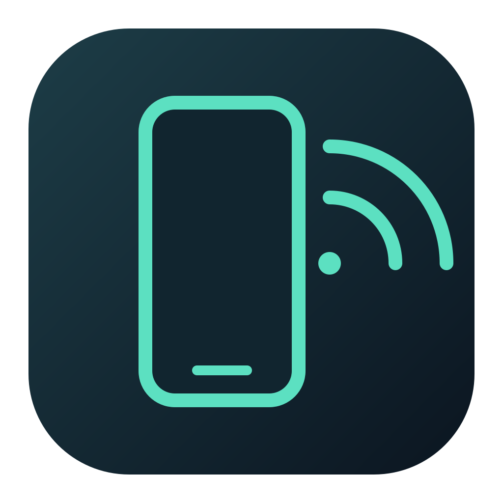

# HarmonyCast 2.0 · 鸿蒙投屏工作台

<p align="center">
  
</p>

<p align="center">
  <b>Native High-Performance Desktop Screen Mirroring, Debugging, and Diagnostics Workbench for OpenHarmony Devices</b><br>
  <b>面向 OpenHarmony / 鸿蒙设备的原生高性能桌面投屏、调试与系统维护工作台</b>
</p>

<p align="center">
  Engineered with <b>C++20 + Qt6 + FFmpeg</b> to deliver hardware-accelerated video mirroring, real-time HiLog streaming, Chrome DevTools integration, and hardware diagnostics.<br>
  完全基于 <b>C++20 + Qt6 + FFmpeg</b> 原生引擎开发，提供硬件加速投屏、实时日志流、Chrome DevTools 联动及硬件维护能力。
</p>

<p align="center">
  <a href="https://github.com/kkzzyyt/HarmonyCast/releases/latest"></a>
  
  
  
  <a href="LICENSE"></a>
</p>

---

## Overview / 概述

HarmonyCast is a professional desktop workbench tailored for developers and testers of OpenHarmony devices (tablets, phones, smart screens, medical devices, and industrial terminals). It supports both USB and wireless Wi-Fi connections, featuring high-speed screen mirroring, touch injection, application debugging, and command execution.

HarmonyCast 是专为 OpenHarmony / 鸿蒙设备（平板、手机、智慧屏、医疗终端及工控屏）研发人员与测试团队打造的桌面级专业工作台。全面支持 USB 有线与 Wi-Fi 无线网络连接，集成高速低延迟投屏、触控注入、应用调试与系统维护功能。

---

## Core Features / 核心特性

### 1. High-Performance Native Architecture / 高性能原生架构
- **Native Implementation / 原生底层实现**: Built with C++20 and Qt 6; packet demuxing, decoding, color conversion, and scaling are executed on background worker threads.
  采用 C++20 与 Qt6 原生构建；视频解包、解码、颜色空间转换与缩放统一在后台多线程流水线执行。
- **Hardware Decoding / 硬件加速解码**: Direct3D 11VA on Windows and VideoToolbox on macOS, with seamless fallback to multi-threaded CPU software decoding.
  Windows 平台支持 Direct3D 11VA 硬件解码，macOS 平台原生直通 VideoToolbox 硬件解码器，异常时自动平滑回退至多线程 CPU 软解。
- **Low-Latency Control / 超低延迟输入**: Direct binary touch and key injection (< 2ms response), bypassing shell process overhead.
  触控与按键经由原生二进制长连接通道注入（响应延迟压至 2ms 以内），消除调用 shell 外部进程带来的开销。
- **Continuous Reliability / 稳定性加固**: Includes a 25-second keep-awake heartbeat, network de-jitter buffering, and an unrestricted session lifecycle without arbitrary inactivity timeouts.
  投屏期间配备 25 秒自动保活唤醒心跳、网络防抖容错缓冲机制，默认永不超时断开。

### 2. Flexible Workbench Layout / 自由分屏投屏工作台
- **Multiple Layout Modes / 多形态布局**: One-click switching between **Horizontal Split**, **Vertical Split**, **Mirror Only**, and **Logs Only**.
  支持一键无缝切换 **左右分屏**、**上下分屏**、**仅投屏**、**仅日志** 四种工作流。
- **Touch and Display Toolbar / 流式触控栏**: Dynamic bitrate selection (1.5M / 4M / 8M), 0°/90°/180°/270° orientation rotation, HD screenshot capture, Home/Back navigation, and F11 full-screen presentation.
  支持画质码率动态切换、多角度画面旋转、原画级高清截图、系统导航键与 F11 全屏演示。
- **Visual Ripple Feedback / 触控交互反馈**: Built-in phone bezel rendering, glowing touch points, and gesture drag trails.
  支持拟真设备外框渲染、微发光触控点与手势滑动轨迹动效。

### 3. Real-Time HiLog Center / 实时 HiLog 日志中心
- **Instant Filtering / 多维度即时过滤**: Real-time filtering by bundle name prefix, log severity (DEBUG / INFO / WARN / ERROR / FATAL), and full-text regex keywords.
  支持按包名前缀、日志级别及正则表达式全文即时检索过滤。
- **Font Zoom Controls / 便捷字号缩放**: Fast zoom in/out/reset buttons, standard keyboard shortcuts (`⌘/+`, `⌘/-`, `⌘/0`), and `⌘/Ctrl + Mouse Wheel` stepless zooming.
  提供专用缩放按钮、标准快捷键及 `⌘/Ctrl + 鼠标滚轮` 无级平滑缩放。
- **Streaming Export / 流式导出与流控**: Pause log ingestion, toggle auto-scrolling, and export logs to clean plain text. Wireless mirroring automatically defers background logging to conserve bandwidth.
  支持日志冻结、自动滚屏切换与纯文本一键导出；无线投屏模式下按需懒加载，确保视频带宽不被挤占。

### 4. WebView Console and DevTools / WebView 控制台与 Chrome DevTools 联动
- **Dual Tab View / 双标签视图**: Inspect device-side hybrid applications via Console logs and Network request lists.
  在工作台无缝查看设备端内嵌 WebView 的控制台日志（Console）与接口网络抓包（Network）。
- **Interactive JS Console / 交互式 JS 控制台**: Execute arbitrary JavaScript expressions directly in the active device WebView target.
  支持在 `JS >` 输入框中向当前设备 WebView 直接注入并执行脚本。
- **Network Request Inspection / 接口抓包与 cURL 导出**: Monitor request method, URL, status code, payload, and response body, with one-click **Copy as cURL**.
  记录接口请求耗时与数据体，右键支持一键复制为标准 cURL 命令。
- **Chrome DevTools Integration / 一键拉起 Chrome 调试**: Click the Chrome button to launch `chrome://inspect/#devices` with inspect target URL copied to clipboard.
  一键唤起 Google Chrome 官方调试页面，调试地址自动写入剪贴板。

### 5. Panoramic Device Information / 全景设备信息看板
- **Connection Guidance / 智能连接指引**: Diagnostic wizard for USB wired and Wi-Fi wireless debugging setups.
  未连接时呈现清晰的 USB 有线与网络调试配置向导。
- **Hardware and OS Specs / 硬件与系统看板**: Manufacturer, model, OS API version, Linux kernel, CPU ABI, UDID, storage, and memory metrics.
  全方位展示设备硬件规格、系统版本、内核与存储容量。
- **Network Interface Inventory / 网络与接口清单**: Enumerate all physical and virtual network interfaces with MAC and IP addresses.
  枚举所有物理与虚拟网卡 MAC 地址及当前分配 IP。
- **Installed Packages List / 应用包名清单**: Searchable list of all installed packages with one-click package name copying and app termination.
  表格化列出已安装全部应用，支持即时过滤搜索与包名复制。

### 6. HDC Command Presets / HDC 常用命令中心
- **Preset Control Actions / 快捷控制卡片**: Mount system partitions read-write (`target mount`), reboot device, wake up, screen off, install/uninstall HAP packages, and transfer files.
  集成一键挂载系统分区读写、安全重启、亮屏/息屏、HAP 应用安装与文件收发。
- **Interactive Terminal / 交互式终端**: Asynchronous execution with process termination, console clearing, and full log export.
  命令实时异步执行，支持中断、清空控制台与终端日志导出。

---

## Release Downloads / 预编译版本下载

Download pre-compiled binaries from [GitHub Releases](https://github.com/kkzzyyt/HarmonyCast/releases/latest):
前往 [GitHub Releases](https://github.com/kkzzyyt/HarmonyCast/releases/latest) 下载对应平台的安装包：

| Platform / 平台 | Package Format / 格式 | Target Architecture / 架构 | Description / 说明 |
| :--- | :--- | :--- | :--- |
| **macOS** | `.dmg` | Apple Silicon (M1/M2/M3/M4) & Intel | Self-contained, drag-and-drop installer / 开箱即用，双击拖拽至 Applications 目录 |
| **Windows** | `.exe` / `.zip` | Windows 10 / 11 / 12 x64 | Portable single-exe, installer, or zip / 单文件绿色版、安装包或绿色压缩包 |
| **Windows Server 2012** | `.exe` / `.zip` | Server 2012 / 2012 R2 x64 | Qt 5.15 compatibility edition / 专用 Qt5 兼容构建，见 [Server 2012 说明](docs/windows-server2012.md) |

> [!NOTE]
> **macOS Security Gate / macOS 首次打开拦截？**
> HarmonyCast uses local ad-hoc code signatures. If macOS displays an untrusted developer prompt, go to **System Settings → Privacy & Security** and click **Open Anyway**, or run:
> 本项目使用本地 Ad-hoc 代码签名。如遇拦截，请在系统「设置」→「隐私与安全性」中点击 **仍要打开**，或在终端执行：
> ```bash
> xattr -cr /Applications/HarmonyCast.app
> ```

---

## Build Guide / 源码构建指南

### System Requirements / 系统要求
- **macOS**: 14.0+ with Xcode / Apple Clang 15+
- **Windows**: Windows 10/11 x64 with Visual Studio 2022 (MSVC 2019/2022 toolset)
- **CMake**: 3.22+
- **Qt**: Qt 6.6+ (`Core`, `Gui`, `Widgets`, `Network`, `Svg`, `SvgWidgets`, `WebSockets`)
- **FFmpeg**: 4.4+ / 6.0+ (`libavcodec`, `libavutil`, `libswscale`)
- **HDC Tool**: Bundled inside application package; optional system DevEco Studio installation.

### Build on macOS / macOS 构建命令

```bash
# 1. Install dependencies via Homebrew / 安装依赖
brew install cmake qt ffmpeg

# 2. Clone repository / 克隆代码
git clone https://github.com/kkzzyyt/HarmonyCast.git
cd HarmonyCast

# 3. Configure and compile / 配置与编译
cmake -B build -DCMAKE_BUILD_TYPE=Release \
  -DCMAKE_PREFIX_PATH="/opt/homebrew/opt/qt;/opt/homebrew/opt/ffmpeg"
cmake --build build -j$(sysctl -n hw.ncpu)

# 4. Run automated test suites / 执行测试
ctest --test-dir build --output-on-failure

# 5. Package standalone DMG / 打包独立 DMG 镜像
./scripts/build_dmg.sh
```

### Build on Windows / Windows 构建命令

```powershell
# 1. Install FFmpeg using vcpkg / 使用 vcpkg 安装 FFmpeg
vcpkg install ffmpeg:x64-windows

# 2. Configure and build with MSVC / 配置与构建
cmake -B build -DCMAKE_BUILD_TYPE=Release `
  -DCMAKE_TOOLCHAIN_FILE="$env:VCPKG_ROOT/scripts/buildsystems/vcpkg.cmake"
cmake --build build --config Release

# 3. Deploy Qt runtime libraries / 部署 Qt 依赖
windeployqt build/Release/HarmonyCast.exe --compiler-runtime
```

---

## Keyboard Shortcuts / 常用快捷键

| Shortcut / 快捷键 (macOS / Windows) | Action / 功能说明 |
| :--- | :--- |
| **`F5`** | Refresh online device list / 刷新在线设备列表 |
| **`F11`** | Enter or exit full-screen presentation mode / 进入或退出全屏投屏演示模式 |
| **`Alt + ←`** | Simulate device Back button / 模拟设备返回键 (Back) |
| **`Alt + Home`** | Simulate device Home button / 模拟设备主页键 (Home) |
| **`⌘ +` / `Ctrl +`** | Increase log font size (+1 pt) / 放大日志字号 (+1 pt) |
| **`⌘ −` / `Ctrl −`** | Decrease log font size (-1 pt) / 缩小日志字号 (-1 pt) |
| **`⌘ 0` / `Ctrl 0`** | Reset log font size (11 pt) / 恢复默认日志字号 (11 pt) |
| **`⌘/Ctrl + Wheel`** | Smooth font size zooming with mouse wheel / 鼠标滚轮实时平滑缩放日志字号 |
| **`Esc`** | Exit full-screen mode / 退出全屏模式 |

---

## Documentation and History / 技术文档与升级历史

- [Upgrade Changelog & History / 详细升级说明与版本历史](CHANGELOG.md)
- [Performance Verification Guide / 性能指标与验证说明](docs/performance.md)
- [Development Roadmap / 功能路线与演进规划](docs/development-roadmap.md)
- [Windows Server 2012 Compatibility Guide / Server 2012 兼容构建说明](docs/windows-server2012.md)
- [Documentation Index / 文档索引](docs/README.md)

---

## License / 许可证

- HarmonyCast is licensed under the **GPL-3.0-or-later** license. See [LICENSE](LICENSE) for details.
  HarmonyCast 原生重构代码基于 **GPL-3.0-or-later** 许可证分发，详见 [LICENSE](LICENSE)。
- Upstream streaming protocol and reference implementation tribute to [OpenHarmony_Scrcpy](https://gitcode.com/OpenHarmony_Tools/OpenHarmony_Scrcpy) (Apache-2.0).
  流协议与参考实现致敬 [OpenHarmony_Scrcpy](https://gitcode.com/OpenHarmony_Tools/OpenHarmony_Scrcpy) (Apache-2.0)。
- Third-party notices and dependencies: see [THIRD_PARTY_NOTICES.md](THIRD_PARTY_NOTICES.md)。
  详细第三方开源组件声明参见 [THIRD_PARTY_NOTICES.md](THIRD_PARTY_NOTICES.md)。
